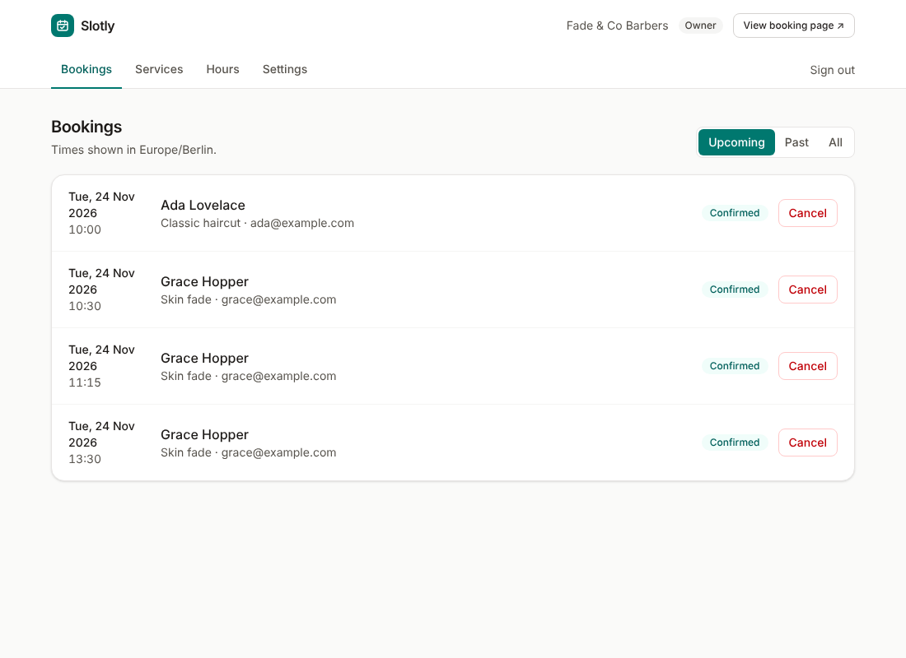
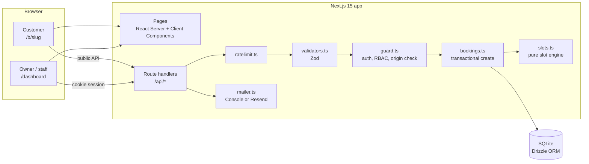

# Slotly

[](../../actions/workflows/ci.yml)

Multi-tenant appointment booking for small businesses (barbers, clinics, tutors). A business signs up, lists its services and weekly hours, and shares one link; customers pick a service, a day and a time, and book without an account.

The interesting parts are the ones that are easy to get subtly wrong: **timezone/DST-correct slot generation** and **double-booking protection**. Both are covered by tests (89 of them, including DST spring-forward and fall-back days).

<p>
  
  
</p>

## Features

- **Owner accounts**: signup/login with bcrypt-hashed passwords and a JWT in an `httpOnly` cookie; roles `owner` and `staff` (staff can see and cancel bookings, nothing else).
- **Business setup**: profile (slug, timezone, currency), services (name, duration, price), weekly opening hours with multiple windows per day.
- **Public booking page** at `/b/[slug]`: service → day → time → details. No customer account.
- **Slot engine** (`lib/slots.ts`): opening hours minus existing bookings, timezone-correct, stored in UTC.
- **No double bookings**: re-checked inside a write transaction, with a unique index as a safety net.
- **Owner dashboard**: list, filter and cancel bookings; cancellations email the customer.
- **Safety rails**: Zod validation on every route, in-memory rate limiting, same-origin check on state-changing requests.
- **Email**: prints to the console by default; sends through Resend when `RESEND_API_KEY` is set.

## Quick start

Requires **Node 22.12 or newer** (see `.nvmrc`; run `nvm use`).

```bash
npm install
cp .env.example .env.local      # optional in dev; JWT_SECRET has a dev default
npm run seed                    # demo business + owner login
npm run dev                     # http://localhost:3000
```

| What | Where |
| --- | --- |
| Public booking page | http://localhost:3000/b/demo-barber |
| Owner dashboard | http://localhost:3000/login → `demo@slotly.dev` / `demo1234` |

The SQLite database is created automatically at `./data/slotly.db`. Booking emails appear in the terminal running `npm run dev`.

### Scripts

| Command | Does |
| --- | --- |
| `npm run dev` / `build` / `start` | Next.js dev server / production build / serve the build |
| `npm test` | Vitest suite (unit + integration through the real route handlers) |
| `npm run typecheck` | `tsc --noEmit` |
| `npm run seed` | Create the demo business (idempotent) |

## Architecture



**Booking a slot, step by step**

1. Browser asks `GET /api/public/:slug/slots?serviceId&date`. The server loads the weekly windows and that day's confirmed bookings and runs them through `generateSlots`.
2. Customer picks a slot and posts `POST /api/public/:slug/bookings` with the slot's UTC start time.
3. The server opens a `BEGIN IMMEDIATE` transaction, **recomputes** the free slots for that day inside the lock, and only inserts if the requested start is still among them. The client's view of "free" is never trusted.
4. A partial unique index `(business_id, starts_at) WHERE status = 'confirmed'` backs this up at the database level.
5. Confirmation emails go out after commit; a mail failure never fails the booking.

### Project structure

```
app/
  api/               route handlers (auth, business, services, availability, bookings, staff, public/*)
  b/[slug]/          public booking page
  dashboard/         owner/staff area
  login, signup, page.tsx (landing)
components/          BookingWidget, AuthForm, dashboard/*, ui.tsx (tiny design system)
lib/
  slots.ts           pure slot generation (the core)
  bookings.ts        availability queries + transactional booking
  schema.ts, db.ts, migrate.ts   Drizzle schema, connection, zero-setup bootstrap
  auth.ts, guard.ts  passwords + JWT, request authentication and RBAC
  validators.ts      every input schema
  ratelimit.ts, mailer.ts, api.ts, serialize.ts, seed.ts, format.ts
scripts/seed.ts
tests/               slots, bookings, api (end-to-end), auth, validators, ratelimit
.github/workflows/ci.yml
```

## Design decisions

**Time model.** Instants (bookings) are integer epoch milliseconds, i.e. UTC. Opening hours are *wall-clock minutes in the business timezone*. "Open 09:00" is a statement about the shop's clock, so on a DST-change day the window really is an hour shorter or longer in absolute time. Slot generation therefore builds each window's start and end from local wall-clock fields via Luxon (never `startOfDay + N minutes`, which drifts across DST), then steps in absolute time. The tests pin down spring-forward (the 02:00 hour doesn't exist), fall-back (01:00 happens twice and both are bookable), half-hour offsets (Kolkata) and a local day that starts on the previous UTC day (Auckland).

**Double-booking.** Two layers, deliberately. The transaction (`BEGIN IMMEDIATE`) serialises writers and re-derives availability under the lock, which handles partial overlaps (10:30 vs an existing 10:00-11:00) that a plain unique constraint cannot see. The partial unique index is the safety net for any code path that skips the check. A cancelled booking doesn't hold its slot (the index only covers `confirmed` rows). Tests cover exact, partial and adjacent overlaps, cancel-then-rebook, two separate connections to one database file, and the raw constraint with the app check bypassed.

**Server-side re-validation.** The booking endpoint accepts a start instant, not "slot #3". It regenerates the day's slots and checks membership, so off-grid times, closed days, past times, the 30-minute minimum notice and the 60-day horizon are all enforced on the server regardless of what the UI offered.

**Auth.** bcryptjs (cost 10) for passwords; HS256 JWT via `jose` in an `httpOnly`, `SameSite=Lax` cookie (`Secure` in production). The token carries only the user id. Role and tenant are re-read from the database on every request, so removing a staff member or changing a role takes effect immediately instead of living on in a 7-day token. Login runs one bcrypt comparison even for unknown emails and returns one generic error, to avoid user enumeration by timing or message. State-changing authenticated requests also check that `Origin` matches the host (CSRF defence in depth on top of SameSite).

**Multi-tenancy.** Shared schema, `business_id` on every tenant table. Tenant scoping happens in the query's `WHERE` clause (`id = ? AND business_id = ?`), taken from the authenticated user, never from the request. Cross-tenant access answers 404, and there are tests for it.

**Validation.** Every route parses its body or query with a Zod schema; errors come back as `{ error: { code, message, details[] } }` with 422. Service durations, prices, slugs, timezones (checked against the IANA database) and overlapping availability windows are all validated.

**Rate limiting.** Sliding-window log in memory: 10 booking attempts/min/IP, 60 slot lookups/min/IP, 10 auth attempts/15 min/IP. Returns 429 with `Retry-After`.

**Mailer abstraction.** A two-method interface with `ConsoleMailer` (default, zero setup) and `ResendMailer` (plain `fetch`, no SDK). Callers never know which one they have.

**Database portability.** Drizzle with `better-sqlite3` for a zero-setup clone-and-run. The schema uses only portable types. `lib/migrate.ts` is plain idempotent SQL for the bootstrap; moving to Postgres means generating real migrations with `drizzle-kit`, swapping the driver, and replacing the transaction/index strategy as described below.

## Trade-offs (what I knew I was giving up)

- **SQLite on serverless.** On Vercel the filesystem is read-only apart from `/tmp`, which is ephemeral and *per instance*. Fine for local use and a single-process host; for a hosted demo that must behave consistently, use Postgres (Neon) or a volume-backed host (Fly.io, Railway, Render). See [Deploying](#deploying).
- **One resource per business.** A business has one calendar: no per-staff or per-room columns. Multi-resource booking needs a `resources` table and the unique index becomes `(resource_id, starts_at)`.
- **In-memory rate limiter.** Per-process, so the effective limit multiplies with the number of instances. Swap the `Map` for Redis/Upstash behind the same `check()` interface.
- **Ambiguous local times.** On a fall-back day, "01:00" appears twice in the picker (they are different instants and both bookable). A production UI would add the UTC offset to disambiguate.
- **No customer self-service cancel/reschedule, no payments, no calendar sync.** All on the roadmap below.
- **Hand-written bootstrap SQL** can drift from `schema.ts`. The test suite exercises every table and column, which would catch most drift, but `drizzle-kit` migrations are the right long-term answer.
- **`better-sqlite3` is pinned to 12.x.** In my testing, v13 made npm attempt a `node-gyp` source build (needs a C++ toolchain, which Windows and many Mac setups lack), while 12.x downloads a prebuilt binary. Revisit when v13's install story settles.
- **`npm audit` reports PostCSS advisories** through the copy bundled in Next 15. They concern processing untrusted CSS at build time, which this app never does, and the fix is a major upgrade to Next 16. Worth doing as a follow-up.
- **TypeScript is pinned to 5.x.** TypeScript 7's native compiler doesn't expose the JS API that Next 15 uses to load `next.config.ts`, so `next build` fails on it today.

## API

All responses are JSON. Errors: `{ "error": { "code", "message", "details?" } }`.

| Method | Path | Auth | Purpose |
| --- | --- | --- | --- |
| POST | `/api/auth/signup` | public | Create business + owner, set session cookie |
| POST | `/api/auth/login` | public | Sign in |
| POST | `/api/auth/logout` | any | Clear cookie |
| GET | `/api/auth/me` | any | Current user and business |
| GET / PATCH | `/api/business` | any / owner | Read / update profile |
| GET / POST | `/api/services` | any / owner | List / create |
| PATCH | `/api/services/:id` | owner | Edit or archive (`active: false`) |
| GET / PUT | `/api/availability` | any / owner | Read / atomically replace weekly windows |
| GET | `/api/bookings?scope=upcoming\|past\|all` | any | List bookings |
| POST | `/api/bookings/:id/cancel` | owner, staff | Cancel (idempotent), email customer |
| GET / POST | `/api/staff` | owner | List team / create staff login |
| DELETE | `/api/staff/:id` | owner | Remove staff |
| GET | `/api/public/:slug` | public | Business + active services |
| GET | `/api/public/:slug/slots?serviceId&date` | public, rate-limited | Free slots for a local date |
| POST | `/api/public/:slug/bookings` | public, rate-limited | Create a booking (409 `slot_taken`, 422 `slot_unavailable`) |

## Testing

```bash
npm test
```

| Suite | What it proves |
| --- | --- |
| `slots.test.ts` | Slot grid, split shifts, partial/adjacent overlap, clock and minimum notice, timezones, DST spring-forward and fall-back, 23/25-hour days |
| `bookings.test.ts` | Double-booking (exact, partial, adjacent), cancel-then-rebook, two DB connections, unique index with the app check bypassed, invalid slots, tenant isolation |
| `api.test.ts` | Full flow through the real route handlers: signup → configure → book → 409 on conflict → RBAC → cross-tenant 404 → CSRF origin check → 429 |
| `auth.test.ts` | bcrypt, JWT round-trip, wrong secret, tampering, expiry, `alg=none`, missing secret in production |
| `validators.test.ts`, `ratelimit.test.ts` | Input rules; limiter window and per-key behaviour |

CI (`.github/workflows/ci.yml`) runs typecheck, tests and a production build on every push and pull request.

## Deploying

Environment variables (see `.env.example`):

| Variable | Notes |
| --- | --- |
| `JWT_SECRET` | **Required in production.** `openssl rand -base64 32` |
| `DATABASE_PATH` | SQLite file path. Defaults to `./data/slotly.db` (`/tmp/slotly.db` on Vercel) |
| `SLOTLY_DEMO_SEED=1` | Create the demo business when the database is empty |
| `RESEND_API_KEY`, `MAIL_FROM` | Enable real email; otherwise emails are logged |
| `INSECURE_COOKIES=1` | Only for running a production build over plain `http://localhost` |

**Vercel (portfolio demo).** Import the repo, set `JWT_SECRET` and `SLOTLY_DEMO_SEED=1`, deploy. Because `/tmp` is per-instance and wiped on cold starts, treat the data as disposable and expect that two requests may occasionally hit different instances. Good enough to click around; not good enough to hand to a client. For a durable deployment, move to Postgres (below) or deploy the same code to a host with a persistent disk.

## What I'd do next

1. **Postgres (Neon).** Swap the driver; replace the app-level check with `SELECT ... FOR UPDATE` on the business row (or an advisory lock), plus `EXCLUDE USING gist (business_id WITH =, tstzrange(starts_at, ends_at) WITH &&) WHERE (status = 'confirmed')` so overlaps are impossible at the database level, not just exact starts.
2. **Customer self-service**: a signed cancel/reschedule link in the confirmation email.
3. **Payments (Stripe)** with deposits. Webhook handlers must be idempotent: store the event id with a unique constraint, process inside a transaction, and make "mark booking paid" a no-op if already applied. Hold a slot with a short-lived `pending` status that expires if payment doesn't complete.
4. **Reminders** via a scheduled job (email/SMS 24 h before).
5. **Per-staff calendars** and buffers between appointments; ICS attachments and Google Calendar sync.
6. **Shared rate limiting** (Upstash Redis) and a login lockout/backoff.
7. **Playwright end-to-end test** of the booking flow, plus ESLint in CI.
8. **Observability**: structured logs, error tracking, a `/api/health` check.

## License

MIT, see [LICENSE](LICENSE).
